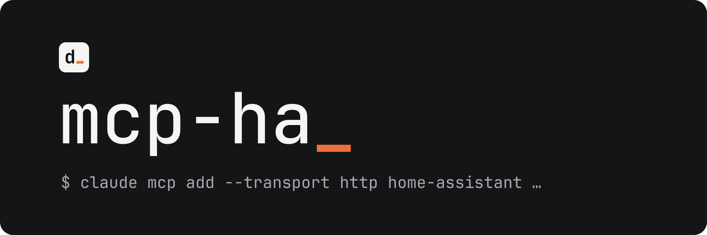

<p align="center">
  
</p>

<p align="center">Talk to your Home Assistant from Claude, Gemini or any MCP client.</p>

<p align="center">
  <a href="https://github.com/Devitek/mcp-ha/releases/latest"></a>
  <a href="https://github.com/Devitek/mcp-ha/actions/workflows/ci.yaml"></a>
  <a href="LICENSE"></a>
</p>

<p align="center">
  <a href="#installation">Installation</a> ·
  <a href="#usage">Usage</a> ·
  <a href="#documentation">Documentation</a> ·
  <a href="mcp_ha/CHANGELOG.md">Changelog</a> ·
  <a href="CONTRIBUTING.md">Contributing</a>
</p>

mcp-ha is a Home Assistant add-on that exposes an [MCP](https://modelcontextprotocol.io) (Model Context Protocol) server. Connect an AI assistant to your instance and ask it things like *"Which lights were left on?"*, *"Why didn't the heating automation trigger last night?"* or *"Plot my energy usage for the week."* It is read-only by default and built to spare the model's context window.

> [!IMPORTANT]
> LAN only: there is no TLS and no OAuth. Do not expose port 9583 to the internet. The full threat model is in [SECURITY.md](SECURITY.md).

## Installation

Requires Home Assistant OS or Supervised (the add-on needs the Supervisor).

1. Add this repository to your add-on repositories:

   [](https://my.home-assistant.io/redirect/supervisor_add_addon_repository/?repository_url=https%3A%2F%2Fgithub.com%2FDevitek%2Fmcp-ha)

   Or manually: Settings, Add-ons, Add-on store, three-dot menu, Repositories, then paste `https://github.com/Devitek/mcp-ha`.

2. Install "MCP Home Assistant" and start it.
3. Open the add-on Configuration tab: an API token was generated and saved there on first start (the log only ever shows a masked prefix).

## Usage

**Claude Code**

```sh
claude mcp add --transport http home-assistant \
  http://HA_IP:9583/mcp \
  --header "Authorization: Bearer YOUR_TOKEN"
```

**Claude Desktop and Gemini CLI**: see the [clients guide](https://devitek.github.io/mcp-ha/guide/clients).

## What it covers

| Domain | Tools |
| --- | --- |
| Entities, areas, devices | fuzzy search, paginated lists, full details |
| Services | catalog per domain, search, guarded call (opt-in) |
| Automations | list, state, last trigger, full configuration, execution traces, guarded creation (opt-in) |
| Diagnostics | health report, execution traces, causality chains (why did this fire?) |
| Scripts | list, running state |
| History | state changes, long-term statistics, logbook |
| Energy | dashboard-backed totals and period comparisons |
| Presence | who is where, zone timeline (zones only, never coordinates) |
| Helpers | create and delete input_*, counters, timers (opt-in) |
| Notifications | send to phones and notify targets (opt-in, rate capped) |
| Announcements | speak on satellites and media players (opt-in, rate capped) |
| Scenes | snapshot the current mood as a scene (opt-in, volatile) |
| Weather | current conditions and forecasts (hourly, daily) |
| Calendar and to-do | events over a window, list items, guarded item management (opt-in) |
| Cameras | still snapshots as images (opt-in) |
| Add-ons | list and details (read) |
| System | Jinja template rendering, HA config, error log |
| Dashboards | list views, guarded card insertion (opt-in) |

45 tools (27 read, 18 guarded write). Responses are compact, paginated and capped, with notes that steer the assistant towards more precise queries.

**Why not the official HA MCP integration?** It works, but it goes through the Assist API: only entities exposed to Assist, no history, no registries, no add-ons, no automation configs. This add-on gives direct, granular access. Both can coexist.

## Security

- **Read only by default.** The service-call tool does not even exist for the client unless you enable `allow_write`.
- **Defense in depth** when writes are enabled: denylist of dangerous services (HA shutdown, shell_command…), glob allow/deny lists for entities, `dry_run` mode, JSON audit trail of every attempt in the log.
- **LAN only.** See the note above and [SECURITY.md](SECURITY.md).

## Documentation

- [Documentation site](https://devitek.github.io/mcp-ha/): installation, configuration, clients, tool reference, architecture (English and French)
- LLM-friendly docs: [llms.txt](https://devitek.github.io/mcp-ha/llms.txt) (index) and [llms-full.txt](https://devitek.github.io/mcp-ha/llms-full.txt) (everything in one file), also indexed on [Context7](https://context7.com)
- [Add-on documentation](mcp_ha/DOCS.md): the page shown in the Home Assistant interface
- [Issues](https://github.com/Devitek/mcp-ha/issues?q=is%3Aissue): the project knowledge base; design decisions and pitfalls carry the `décision` and `écueil` labels (in French)

## Contributing

Contributions are welcome. Please read [CONTRIBUTING.md](CONTRIBUTING.md) first: one issue per change, Conventional Commits, green CI.

## License

Released under the [MIT License](LICENSE).

---

<p align="center">
  <a href="https://github.com/Devitek">
    <picture>
      <source media="(prefers-color-scheme: dark)" srcset=".github/assets/devitek-wordmark-blanc.svg">
      
    </picture>
  </a>
  <br>
  <sub>Built and maintained by <a href="https://github.com/Devitek">Devitek</a></sub>
</p>
